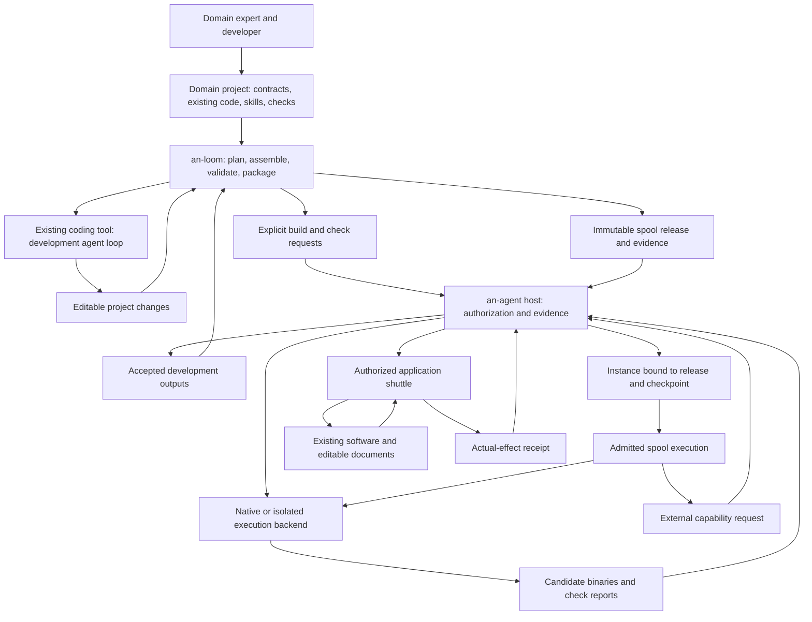

# an-loom: spool development workbench

Status: accepted direction, 2026-10-24. Implementation and migration acceptance
are tracked separately; a target capability is not an implemented guarantee.

## Purpose

an-loom helps developers turn domain knowledge, existing programs, skills and
application integrations into inspectable, reusable spool releases. It provides
project authoring, assembly, development-tool integration, validation orchestration
and delivery. Its implementation is Rust, with deterministic transformations at
the center and explicit adapters for effects.

The product goal remains natural assistance inside existing applications.
an-loom serves the developers who make that assistance possible. CLI support
comes first; a graphical workflow editor is optional future presentation.

## Observed starting point

The inspected an-waver main checkout provides content-addressed file packaging,
archive verification, explicit include lists, bounded source inspection, starter
templates, build-result reception and command briefs for other coding tools.

Its spool adapter assumes a fixed Rust source path and executable and accepts
two predefined stdio/file profiles. Declaration generation is tied to those
profiles. Code-tool integration prepares instructions rather than managing a
complete development session. These are useful foundations, but do not yet
provide a project model for assembling existing multi-component domain workflows.

The inspected an-agent host already has execution backend reconciliation,
immutable artifact revisions, bounded instance commits and checkpoint delivery.
Those implementations remain narrow acceptance profiles. A replacement developer
tool must not advertise a general runtime that the host cannot admit or execute.

## Responsibilities

| Component | Owns |
| --- | --- |
| an-loom | Authoring contracts, scaffolds, explicit component bindings, code-tool adapters, build/check plans, package evidence, release assembly and delivery clients |
| an-agent host | Admission, grants, scoped model/context services, execution coordination, durable instance/checkpoint publication, artifact custody, delivery evidence, retention decisions and audit |
| Execution backend | Enforced process/VM isolation, execution lifecycle and observed termination; backend-specific snapshot operations where supported |
| Spool release | Domain workflow, skills, agent instructions, business decisions, state schemas, migrations and domain acceptance rules |
| Kit | A callable domain computation with declared inputs and outputs; normally exposed by a CLI |
| Shuttle | Application integration, including native APIs or GUI interaction, target revision checks and actual-effect receipts |
| an-agent-shuttle repository | A collection of domain integrations and reusable components; it is not a runtime layer |

Domain behavior belongs to spool projects. an-loom understands how to build,
check and deliver them, without interpreting their engineering, artistic or
other domain rules. Checks supplied by a project run as untrusted code inside
an explicitly authorized development boundary.

## Development and execution flow

an-loom constructs development plans; an-agent admits and supervises actual
controlled executions. A package remains usable without linking the developer
tool, and a kit can retain a standalone CLI. Offline authoring and package
verification do not require a running an-agent service.

## Project, release and instance

Keep these objects distinct:

- **Project:** editable source, domain documentation, component bindings,
  generation instructions, fixtures and development commands.
- **Release:** an immutable inventory of selected package bytes and dependencies,
  entrypoints, capability requests and identified validation evidence.
- **Instance:** a host-managed identity bound to a release, permissions and a
  committed checkpoint. Live state and credentials are not release payloads.
- **Attempt:** one admitted execution with its own identity and outcome.

A spool may contain several kits and agent instructions. It requests shuttle
capabilities; every application bridge does not need to be copied into every
spool. A bounded internal workflow may initially use an ordinary reviewed runner
inside the spool. A new runtime workflow language is not required for the first
development workbench.

## Interfaces and authority

Start with explicit CLI requests and machine-readable records at the host
boundary. Use the host's existing authoritative descriptor validation and
execution profiles. Add a missing host operation only when a real integration
demonstrates the gap; never replace unsupported authority with a generated shell
command or an apparently successful package check.

Authoring declarations are developer requests. Source analysis reports observed
signals and unknowns. A host grant is a separate decision. Build evidence binds
source, executable, dependency and configuration identities to the extent actually
observed; a digest does not prove safety or reproducible compilation.

The developer configuration may use TOML, while deployment uses the host's YAML
contract. Reuse existing schemas and serializers where they are adequate. The
first workbench should not invent a parallel runtime schema for the same rules.

No reverse implementation dependency is required from an-agent to an-loom.
Host compatibility is checked through versioned public contracts and pinned
integration acceptance. Both repositories may change in coordinated PRs without
sharing business logic or requiring a common release cycle.

## Mature coding tools

External coding tools keep their own model loops, context compaction and editing
mechanisms. an-loom supplies a bounded task, relevant project references, allowed
kit entrypoints and acceptance criteria, and receives editable changes and
identified results. It does not implement a competing general coding agent.

They also own their native session tape. The host retains execution, authority,
termination and artifact handoff receipts; it need not ingest every model/tool
event. Direct model API envelopes are an optional integration choice. Filesystem
backup does not establish external effects or billing. See the proposed
[coding-tool contract](code-agents.md); no live provider adapter is qualified yet.

Adapters declare whether a tool's model session is managed by the tool or
forwarded through a host service. Tool-managed model calls are outside any claim
of complete host model-call supervision. Credentials stay in the corresponding
trusted service and do not enter spool payloads or untrusted build environments.
Deployed spools request host model services under their runtime grants.

Invoking an existing kit should be simpler than asking a coding tool to recreate
it. Expose its contract, approved host invocation and bounded result references.
Prompt instructions are guidance; the execution boundary enforces permissions.

## State, artifacts and recovery

The spool defines its state schema, transitions and migrations. The host holds
committed state bytes, checks revision preconditions and records publication.
The backend owns process/VM state and any supported snapshot operation. A VM
snapshot is an optional execution optimization, not the portable business state.

Only explicitly delivered and host-accepted outputs become formal artifacts.
Scratch files are disposable after confirmed termination and retention checks.
Artifacts referenced by retained checkpoints or awaiting required consumption
remain retained. Delivery acknowledgements derive from committed consumption
evidence; missing acknowledgements alone do not authorize duplicate execution.

Continuing from a release and checkpoint also requires available dependencies,
authorized services and valid referenced inputs. It does not guarantee restoration
of external systems, model behavior or uncommitted actions. Unknown external
outcomes require reconciliation, never unconditional replay.

An existing workflow may need internal cache and work files together to resume.
Retain these only under an explicit host-visible resume lease; otherwise the
default remains disposable scratch after confirmed termination and retention
checks. A workflow's internal filenames are not downstream artifact contracts.
The proposed observation and file-management acceptance are in the
[roadmap](roadmap.md).

Release hashes identify bytes, not authorized spool lineage or upgrade
compatibility. Keep publisher-scoped logical identity, immutable release identity
and host instance/checkpoint identity separate. The
[identity research](spool-identity.md) must precede a new update schema.

## GUI boundary

A shuttle may use an application API or a GUI execution service. GUI capability
authorization, observation identity, target freshness and actual-effect readback
must remain explicit. Disconnecting or timing out a call does not establish that
an input action stopped. A GUI service is not interchangeable with a file-kit
backend solely because both execute requests.

## Minimal implementation shape

Begin with one Rust workspace and a small CLI. Establish module boundaries before
creating numerous public crates:

- `project`: parse and normalize authoring inputs and component bindings.
- `plan`: derive explicit generation, build, check and release plans.
- `adapters`: invoke existing coding tools and host CLI operations.
- `evidence`: validate bounded reports and their input/output identities.
- `release`: inventory, verify, assemble and export identified package bytes.

Domain templates and example projects live outside these generic modules.
Runtime state, delivery ledgers, provider credentials and VM controllers remain
outside the workbench.

## Migration and first acceptance

1. Establish the public project contract, README, architecture and contributor
   rules. Use the `an-loom` name consistently for the repository, package and CLI.
2. Port useful an-waver validation and archive code with its license and source
   attribution. Reorganize around projects and plans; avoid copying all historical
   commands or changing the host deployment format without demonstrated need.
3. Adopt an existing lightweight file kit as a project. Generate a reviewable
   change using one mature coding tool, invoke host-controlled build/check,
   receive verified output, assemble a release, register and run it through the
   real host. Record unsupported host capabilities as gaps.
4. Validate the same authoring-to-release route with an independently structured
   existing kit. This is the evidence for generality before adding a visual
   editor, provider catalog or a more elaborate workflow language.
5. Move required examples, CI references and design evidence. Then mark an-waver
   superseded, make it private and archive it. Preserve history; avoid deleting
   material needed to reproduce old releases.

The first milestone is complete when a developer can inspect and reproduce the
project-to-release route, replace its domain code without editing an-loom, and
consume the release without depending on the workbench. Supported refusal,
cancellation and acceptance behavior must come from the actual host contract.
