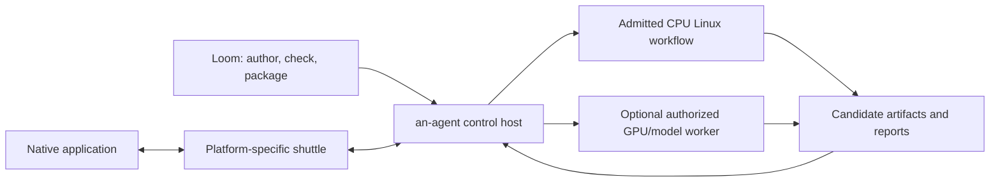

# Host, application and workflow targets

The desired split is coherent when these targets are explicit:

| Target | Packaging and responsibility | Current evidence |
| --- | --- | --- |
| an-agent control host | Per-OS/CPU binaries; grants, context, supervision and custody | Native file execution on macOS/Linux CI; workspace development on macOS |
| Application shuttle | Per-application OS integration, native API or GUI | Qualified separately by each shuttle; no universal GUI promise |
| Workflow/spool | CPU Linux by default, pinned architecture/dependencies; alternative profiles explicit | Policy direction; this Kimi development example still uses the existing macOS build profile |
| Loom | Native development/packaging CLI; describes requirements and delegates execution | Linux/macOS packaging and quality CI |

Per-target Rust binaries help distribution. They do not make one executable run
on every system or reproduce filesystem, sandbox, GUI and driver semantics.
Cross-compilation needs target libraries, an appropriate linker and native
dependencies; see [Rust's target guidance](https://rust-lang.github.io/rustup/cross-compilation.html).
Protocol/process boundaries are preferable to assuming a portable Rust dylib ABI.
Windows remains unqualified here.

This is a target ownership diagram, not a claim that new Linux/GPU backends ship
in this PR. A local ARM Linux VM is a reasonable initial CPU development target;
native Linux must not require Lima or Docker. Existing macOS-only build profiles
must be separately adapted and qualified before advertising Linux development.
Do not use the trusted workspace job profile to contain an untrusted coding agent.

CPU Linux as the default does not prohibit a GPU-dependent workflow. Declare a
separate execution variant, request a host-mediated remote model/GPU service, or
use an application-specific native shuttle. The host controls credentials,
network and artifact exchange. Cancellation confirmation and late-result rejection
must be qualified for remote work. Never silently run an unsupported GPU task on
CPU, grant a broader host shell, or assume VM GPU passthrough.

Domain authors choose algorithms and device requirements; Loom checks explicit
project/deployment contracts; an-agent admits capabilities; the selected backend
enforces them. A default policy is not an automatic cross-platform converter.
