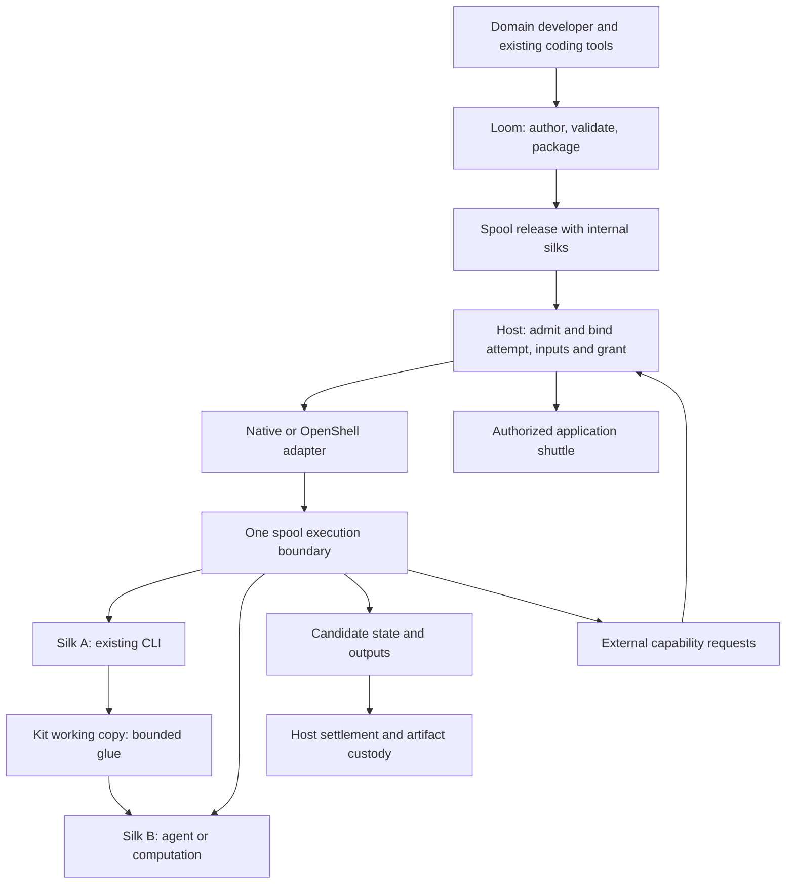

# Spool boundary, internal silks and backend independence

Status: target code-role contract with existing naming compatibility. No new runtime or isolation
promise is introduced. Loom remains a Rust developer/packaging tool.

## Canonical terms

- **Spool release:** an immutable domain package with workflow code, silks,
  skills, configuration, dependency bindings, state formats and domain checks.
- **Spool instance:** a release-bound business identity and committed state.
- **Spool attempt:** the host-owned execution isolation and lifecycle unit.
- **Silk:** release-bound core code and pipeline skeleton, read-only during an
  attempt. Development changes require validation and a new release.
- **Kit:** internal glue; agents may adapt explicitly editable working copies.
  Packaged baselines remain immutable, temporary copies are scratch by default.
  See [the code contract](spool-code.md). Neither class gets its own VM/grant.
- **Shuttle:** a bridge for separately authorized external application access.
- **Backend:** implementation of the host's execution boundary. OpenShell is
  optional and replaceable; it is not a package dependency or semantic engine.

Development can reuse silk source independently. Managed execution must bind the
selected implementation to its owning spool release and attempt. A silk cannot
self-register authority, select a weaker backend or publish directly into the
host artifact catalog. A shared library or content reference does not escape
release identity checks. Different attempts do not implicitly share writable state.

The host admits a spool attempt and chooses an adequate backend from operator
configuration. Silks run inside the attempt's effective authority. Additional
inner isolation is possible only as an explicit requirement; one sandbox per
silk is not the default. Unknown or insufficient enforcement must refuse execution.

Loom describes selected implementation and requested capabilities. It must not
control runtime VMs, infer a safe backend from an LLM assessment, or issue grants.
Domain sequencing stays inside the spool; packaging does not add a generic DAG
scheduler. Semantic checks remain pure assessments outside vendor-specific adapters.
State/artifact commits and retention belong to the host, outside disposable scratch.
A silk exit is not evidence that the whole spool attempt has terminated.

## Current implementation audit

| Surface | Implemented | Still missing |
| --- | --- | --- |
| Project/package/release | Allowlisted files, deterministic inventory, bounded verification and fixed host deployment | General multi-silk authoring/runtime contract |
| CLI source binding | One Rust entrypoint, build record, declaration and source evidence | Arbitrary dependency assembly and internal dispatch |
| Embedded host bodies | Existing trusted in-process `SpoolBeat` integration | Mounting is not execution isolation; this is not an untrusted spool runner |
| Host file deployment | Release-bound single entry; Native/OpenShell share operation settlement | Whole-spool multi-step execution in one environment |
| Reviewed workspace examples | Trusted operator-selected workflows, binary custody and native editor evidence | Production spool identity/authority binding; not a hostile-agent sandbox |
| OpenShell adapter | Optional qualified single-program file profile | Broad agent/network/credential coverage must not be inferred from upstream support |

## Existing authoring compatibility

New generated `loom.toml` files emit `[silk]`. The parser accepts either `[silk]`
or the old `[kit]`, never both; this alias does not declare editable glue; duplicate declarations are rejected even when
identical. Both forms undergo the same path containment, allowlist and fixed
profile validation. This is naming compatibility, not a new host deployment ABI.

`project::Silk` and `Project::silk()` are canonical Rust names. The existing
`Kit` alias, `Project::kit` field and `kit()` accessor remain source-compatible.
Internal `kit/` paths and `file-kit-v1`, `build-kit`, `kit.request`/`kit.execute`
wire tokens remain unchanged. Already-published archives are read and verified
as their original bytes, never automatically rewritten. Explicit source edits,
including adopting `[silk]`, produce a different package identity and invalidate
approvals bound to old project bytes.

Historical Silk protocol and Silksong data keep their original meaning. A new
executable silk is not that protocol. Do not reclassify old tape or communication
records by string replacement. A later protocol migration needs explicit schemas.

## Next bounded slices

1. Land these contracts and compatible authoring names without changing isolation.
2. Bind production requests to an owning spool release/attempt, selected internal
   program, input/state versions and effective grants. Keep developer workspace
   execution visibly separate until it satisfies that contract.
3. Reconcile real execution paths using existing host identity, cancellation,
   artifact and retention mechanisms. Only add missing capability fields backed
   by platform/version/profile evidence. Preserve CLI compatibility and refuse
   weaker fallback; do not add a second VM backend.
4. Qualify one spool with two internal silks in one execution environment. Verify
   that no inner call provisions a VM, cancellation covers remaining workers,
   stale generations cannot publish, and accepted artifacts survive reclamation.
5. Consider persistent environments, pause/suspend or another backend only after
   concrete use requires them. Snapshot/restore is not business-state recovery or
   rollback of external application effects.

The host owns runtime enforcement and acceptance. Loom can check declarations
and prepare tests, but cannot certify those guarantees from a successful build.
