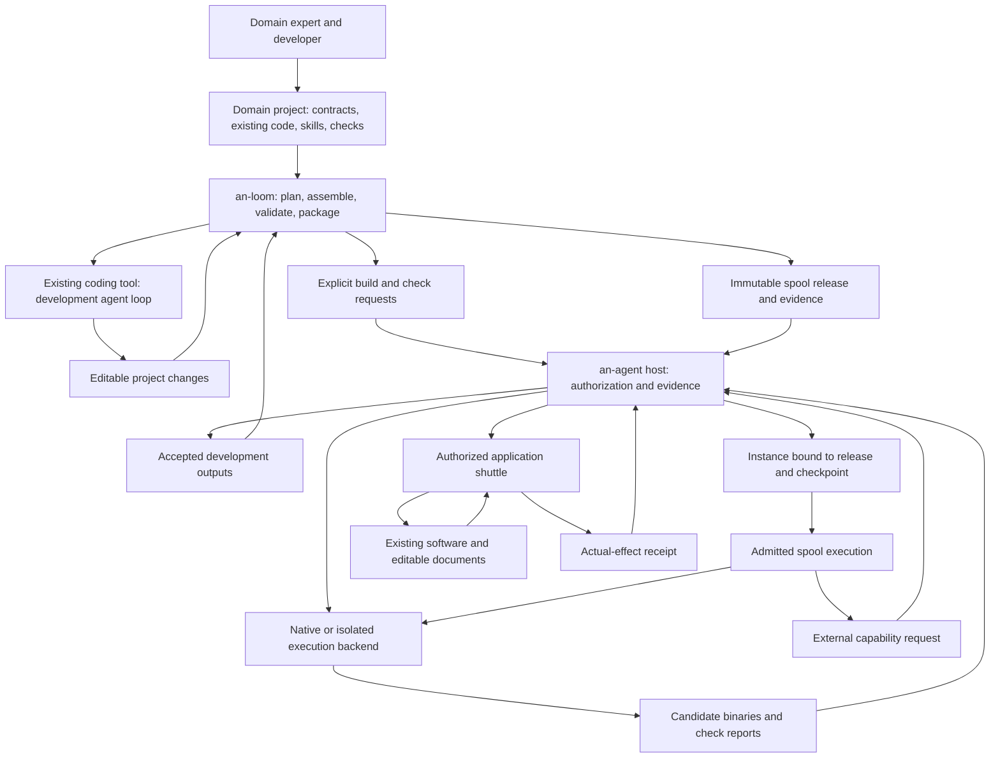

# an-loom: spool 开发工作台

[English](../../architecture.md) · 中文译文，以英文为准。 · [中文目录](../README.md)

状态：已接受方向，2026年10月24日。实现和迁移接受度分别跟踪；目标能力并不表示已实现的保证。

## Spool 执行边界

一个spool尝试拥有授予的执行环境和生命周期。其释放文件携带**silk**基准标签；可变衍生品和新工作携带**kit**标签。见[代码契约](spool-code.md)。它们并不各自获得一个VM或独立的授权。OpenShell是一个可替换的宿主后端，从不作为Loom或语义依赖项存在。其扩展被暂停；原生头less生命周期工作是当前优先事项。后端适用性由宿主所有，并且是失败封闭的：包检查或一个头less接口无法证明比更强的隔离性或自动原生回退更弱。现有单程序配置是受限的特化，而非一个完成的多silk运行时。见[实现审计和分阶段迁移](spool-boundary.md)。遗留的`kit`拼写和历史Silk通信记录仍作为兼容性数据保留。

## 目的

an-loom 帮助开发者将领域知识、现有程序、技能和应用集成转化为可检查、可复用的 spool 发布。它提供项目作者化、装配、开发工具集成、验证 orchestration 和交付。其实现以 Rust 为中心，采用确定性转换，并为效果提供显式适配器。

产品目标仍保持在现有应用中提供自然辅助。an-loom 服务于使该辅助成为可能的开发者。CLI 支持首先，图形工作流编辑器为未来可选的呈现形式。

## 已实现的起点

Loom 提供允许列出的内容地址包装、档案验证、受限源检查、起始模板、候选/检查身份绑定、构建结果接收和受限任务，以支持现有编码工具。遗留部署适配器保持为固定 Rust 源码，并包含两个预定义配置。独立的 [原生 spool 适配器](native-spool.md) 以发布绑定方式导出 silk/kit 角色、无头运行时请求、显式状态槽和 v3 事件。通用包装不意味着任意控制的运行时支持。

配对接受验证了真实原生实例，包括套件编辑/重置、取消、固定产物/状态、有限事件操作和私有材料集合。宿主拥有这些保证。Loom不取代编码工具的会话，宿主的监督者，或领域项目自身的流程/接受规则。使用[开发轮次](development-rounds.md)进行作者/检查状态的编写/验证，使用[原生吐司](native-spool.md)进行合格包/宿主交接。

## 责任
- 负责项目管理
- 管理资源
- 负责任务执行
- 负责进度跟踪
- 负责质量控制
- 负责风险控制
- 负责沟通协调
- 负责文档记录

| 组件 | 自有 |
| --- | --- |
| an-loom | 作者化合同、骨架、显式组件绑定、代码工具适配器、构建/检查计划、包证据、发布装配和交付客户端 |
| an-agent host | 授权、授予、受限模型/上下文服务、执行协调、持久实例/检查点发布、构件保管、交付证据、保留决策和审计 |
| 执行后端 | 确保作业边界并报告环境生命周期/终止；OpenShell 是一个可替换实现 |
| Spool 发布 | 领域工作流、技能、代理指令、业务决策、状态模式、迁移和领域验收规则 |
| Silk | 每个不可变的发布基准文件，包括代码、配置和指令 |
| Kit | 被授权的可变衍生品和新工作；指令保护和授予是独立的 |
| Shuttle | 应用集成，包括原生API或GUI交互、目标版本检查和实际效果确认 |
| an-agent-shuttle repository | 一个领域集成和可复用组件的集合；它不是一个运行时层 |

领域行为属于 spool 项目。an-loom 理解如何构建、检查和交付它们，而不解释其工程、艺术或其他领域规则。由项目提供的检查作为不受信任的代码运行在明确授权的开发边界内。

## 开发和执行流程 /no

an-loom 构建开发计划；an-agent 接收并监督实际控制执行。一个包在不链接开发工具的情况下仍可使用，一个 silk 可以保留独立的 CLI。离线作者和包验证不需要运行 an-agent 服务。

## 项目、发布和实例

保持这些对象明确区分：

- **项目**：可编辑源代码、领域文档、组件绑定、生成指令、固定值和开发命令。
- **发布**：选定包字节和依赖项的不可变库存、入口点、能力请求和已识别验证证据。
- **实例**：与发布绑定的宿主管理身份，权限和已承诺的检查点。活态状态和凭证不属于发布载体。
- **尝试**：一个被接受的执行，拥有自己的身份和结果。

一个 spool 可以包含多个 silks 和 agent 指令。它请求运输能力；每个应用桥不需要将整个副本复制到每个 spool。一个受限内部工作流可能最初使用普通审核运行器在 spool 内部。新的运行时工作流语言不是第一个开发工作台所必需的。

## 接口和权限

从宿主边界开始，使用明确的 CLI 请求和机器可读记录。使用宿主现有的权威描述验证和执行配置文件。仅当真实集成演示出差距时才添加缺失的宿主操作；永远不要用生成的 shell 命令或看似成功的包检查来替换不支持的权限。

作者声明是开发者的请求。源分析报告观察到信号和未知项。宿主授权是一个独立的决策。构建证据将源代码、可执行文件、依赖项和配置身份绑定到实际观察到的程度；一个摘要不证明安全或可重复编译。

开发者配置可使用 TOML，而部署使用宿主的 YAML 合同。重用现有模式和序列化器，当它们足够时。第一个工作台不应为相同规则发明并行运行时模式。

an-agent 不需要从 an-loom 获取反向实现依赖。宿主兼容性通过版本化公共合同和钉定集成接受度检查。两个仓库可以在协调的 PR 中变化，而不共享业务逻辑或要求共同的发布周期。

## 成熟的编码工具

外部编码工具保持自己的模型循环、上下文压缩和编辑机制。an-loom 提供一个受限任务、相关项目引用、允许的 silk 入口点和接受标准，接收可编辑更改和识别结果。它不实现一个竞争的通用编码代理。

它们还拥有自己的原生会话日志。宿主保留执行、权限、终止和制品交接记录；它不需要摄入每个模型/工具事件。直接模型 API 长度是可选的集成选择。文件系统备份不建立外部效果或计费。参见提出的 [编码工具合同](code-agents.md) 和限定的 [原生 MCP 评估](../examples/finite-mcp/README.md)。原生 CLI 是受信任的操作员软件；其模型请求仅获得有限的宿主能力。

适配器声明工具的模型会话是否由工具管理，或通过宿主服务转发。工具管理的模型调用超出任何声称的完整宿主模型调用监督。凭证留在对应的受信任服务中，不进入 spool 载荷或不受信任构建环境。部署的 spools 在其运行时授权下请求宿主模型服务。

## 状态、产物和恢复

spool 定义其状态模式、状态转换和迁移。宿主持有已提交的状态字节，检查修订前提条件并记录发布。后端拥有进程/虚拟机状态以及任何支持的快照操作。一个虚拟机快照是可选的执行优化，而不是可移植的业务状态。

只有明确交付并由宿主已验收的输出才成为正式产物。临时文件在确认终止和保留检查后可被丢弃。由保留检查点或等待所需消费的产物所引用的产物仍会被保留。交付确认来自已提交的消费证据；缺少确认本身不足以授权重复执行。

从一个发布和检查点继续执行也要求可用依赖、授权服务和有效引用输入。它不保证恢复外部系统、模型行为或未提交的操作。未知外部结果需要进行协调，而非无条件的重放。

一个现有的工作流可能需要内部缓存和工作文件一起恢复。仅在明确宿主可见的恢复租约下保留这些产物；否则在确认终止和保留检查后，默认值将变为可丢弃的临时文件。工作流的内部文件名不是下游产物合同。提出的观察和文件管理接受度在[roadmap](roadmap.md)中说明。

发布哈希标识字节，而不是授权的spool线性或升级兼容性。保持发布者作用域的逻辑身份、不可变的发布身份和宿主实例/检查点身份分离。[身份研究](spool-identity.md)必须在新更新方案之前进行。

## GUI边界

一个穿梭可能使用应用程序API或GUI执行服务。GUI能力授权、观察身份、目标新鲜度和实际效果读回必须保持明确。断开或超时一个调用并不表明输入动作已停止。GUI服务不因两者都执行请求而与文件-kit后端互换。

## 最小实现形状

从一个Rust工作区和一个小的CLI开始。在创建众多公共crate之前，先建立模块边界：

- `project`：解析和规范化作者输入和组件绑定。
- `plan`：显式生成、构建、检查和发布计划。
- `adapters`：调用现有编码工具和宿主CLI操作。
- `evidence`：验证受限报告及其输入/输出身份。
- `release`：库存、验证、组装和导出已识别包字节。

领域模板和示例项目位于这些通用模块之外。运行时状态、交付账本、提供者凭证和VM控制器保持在工作台之外。

## 迁移和首次接受 /no_check

1. 建立公共项目合同，README文件，架构和贡献者规则。使用`an-loom`名称一致地为仓库、包和CLI命名。
2. 将有用的an-waver验证和归档代码与其许可证和源代码归属一并移植。重新组织围绕项目和计划；避免复制所有历史命令或改变宿主部署格式，除非有充分的需要。
3. 采用一个现有的轻量级文件silk作为项目。生成一个可审查的变更，使用一个成熟的编码工具，调用宿主控制的构建/检查，接收验证过的输出，组装一个发布版本，注册并运行其通过真实宿主。记录不支持的宿主能力作为缺口。
4. 用一个独立结构的现有silk验证相同的作者创建到发布路线。这是在添加视觉编辑器、提供者目录或更复杂的流程语言之前，通用性的证据。
5. 移动所需示例、CI参考和设计证据。然后使an-waver过时，使其私有并归档。保留历史；避免删除需要重现旧发布版本的材料。

第一个里程碑在开发者能够检查并重现项目到发布路线，无需编辑an-loom，且能够消费发布版本而不依赖工作台时完成。支持的拒绝、取消和接受行为必须来自实际宿主合同。

## 平台政策

见[平台边界](platforms.md)。宿主、中转和工作负载目标是独立的。本地审查的无图形执行是当前交付目标；未来Linux配置需要独立资格。每个目标的二进制不意味着可移植沙箱或GUI语义。GPU/平台变体必须明确。Loom描述并验证需求；宿主授予执行权，而后端执行选定的边界。

## 支持、耦合和入侵

[日志报告接受](log-report-workflow.md)区分了通用支持与显式适配器耦合和领域入侵。宿主字节/版本/执行契约支持任何承认的silk；文档库和格式规则保持在示例中。可选的CLI适配器可能依赖于一个合格的宿主契约，而silk保持独立可调用。新后端类型不需要演示这种划分。

## 实现边界审计

开发者/运行时划分仍保持初衷：Loom没有运行时-crate或模型-客户端依赖；an-agent不依赖Loom。当前构建传递和文件部署配置是合格的适配契约，而非通用运行时实现。领域源码和接受规则保持在项目中。

| 模块 | 所有者 |
| --- | --- |
| `project`, `manifest`, `package` | 可编辑声明，包括路径/秘密规则，库存，归档身份和验证 |
| `files` | 作者和打包共享的受限常规文件读取；无宿主协议 |
| `plan` | 显式操作者批准检查；无运行时授权 |
| `adapters/host/development` | 一个批准的构建请求和接收/声明顺序 |
| `adapters/host/transport` | 明确调用操作者选择的宿主CLI |
| `adapters/host/build_artifacts` | 验证和可移植的构建确认 |
| `adapters/host/file_profile` | 源信号，确定性的文件-配置YAML，验证和部署导出 |
| `release` | 专属本地发布交付和身份检查；无宿主激活 |

公共 `build_artifacts`, `spool`, 和 `adapters::develop` 路径仍保持兼容性。现有配置字符串、YAML 字节、发布摘要和CLI命令均未发生变化。通用包代码使用了明确的离线配置检查调用；它在检查或验证归档文件时从不启动宿主。配置适配器可以进一步请求包检查以支持显式作者操作。这属于实现耦合的边界情况，而非新的扩展系统。

文件读取器不再位于构建证据接收器内部：通用档案和项目操作不应依赖特定宿主的接收格式来读取文件。相反，将宿主模式封装在适配器后，其验证的权威性并不因此增强。代理必须仍然验证/接受发布、监督执行并接受其自身授权和结算门的输出。

宿主CLI适配器调用可信操作软件。其输出容量在捕获后被检查，它不是不受信任的代理沙箱或竞争的取消监督程序。后端取消、终止证据、构件版本和保留状态仍保留在代理中。原生编码代理上下文和日志除非有明确的集成合同说明，否则仍保留在相关工具中。

验证保持现有测试目标名称和忽略的实宿主套件。除了常规的单元/契约检查外，应在确认协调接受前，将当前宿主通过 `tests/host_handoff.rs` 运行当前Loom。CI-锁定的历史宿主仍作为独立的兼容性检查；不要重写其历史证据或默然将其标记为移动分支。

## 首次发布绑定的原生spool切片

Spool 交互使用工作区事件和，当分别限定时，使用通道。业务分支、循环、子任务委托和结果解释属于silk/kit。宿主路由并授权事件驱动的尝试；Loom验证接口并打包代码，而不定义全局执行业务图。原生v3 artifact-event适配器是一个受限的前台传递，没有后台监听器、GUI操作或低延迟数据平面。参见native-spool.md。

[原生包适配器](native-spool.md)导出受限的壳代码释放和显式Python/二进制请求，这些请求基于独立选择的宿主环境配置给代理已审查的原生配置文件。宿主实例拥有可变的kit副本、固定代码尝试和托管权。Loom不管理运行实例。这添加了没有通用工作流程引擎、依赖解析器或代理运行时。

日志报告示例通过工作区事件，实现了两个无头喷墨（headless spools）之间固定版本的XLSX/PPTX交换。文档解析保持在示例中；环境选择、执行和保管仍由宿主所有。

## 候选项到发布托管

织布机在执行前会冻结选定候选字节及其完整释放清单。宿主接收一个经过明确审核的配置文件，将其映射到一个只读快照，并监督该过程，接受声明的输出结果。织布机校验该保留的账本并发布相同的冻结档案。内容身份、请求身份和宿主执行尝试是相互独立的。既没有模型断言，也没有独立的操作器成功记录，也不能替代符合资格的执行证据。请参见[合同](candidate-checks.md)。

## 群体与留存协调

宿主管理着对制品的保留期限、有限的分发队列以及受限的Peer上下文。Loom对已打包的程序进行接口验证。详见[开发移交](session-retention-handoff.md)中当前合同及其限制。

## 上下文与工作交接原则

[宿主架构](https://github.com/lazyalexander/an-agent/blob/dev-advance/doc/architecture.md)与Loom共享四项未来开发/引导消费者的设计规则：

1. 在汇总或分页前，按可见性过滤上下文。保留源码、精确修订、目的、受众和读取指针；摘要继承披露限制。这些是设计约束，而非通用上下文路由声明。
2. 区分上下文交付、工作请求和执行授权。订阅和项目指令不能增加权限。工作区持有材料和事实；定向的分发消息通过授权协议传输。
3. 保持事件处理所有权与授权溯源分离。谁必须处理、确认或返回信息并不决定谁可披露或执行副作用。关联提供上下文仅。
4. 保持持续工作目标和交接状态与每个接受尝试分离。精确输入/状态和终止证据属于宿主。一个待办目标或恢复提示不能授权重试未知执行。

Weaver/harness适配器可准备角色提示、分页上下文、人工交接和恢复检查建议。Loom准备并验证开发材料，打包选定字节。宿主授予访问权限，监督执行并拥有状态/制品所有权；无模型循环或运行时监督进入Loom。外部应用程序的讨论“Thread”不是操作系统线程。

设计参考：[dsh-superagent-prototype at 6337fc8](https://github.com/deepseek-ai/dsh-superagent-prototype/tree/6337fc823ce20251c8de8085948165c81aaa701e)。其领域/授权/执行文档和效果队列测试在实现匹配需求时很有用。全权限执行和自动重启重新分配不是继承保证。这是参考，而非依赖或代码导入。GitHub/Feishu集成被推迟，可能后期作为可选能力测试，而非主要交付目标。
