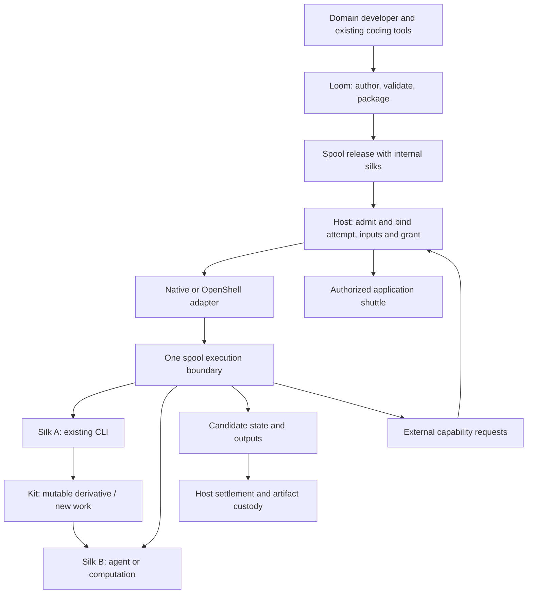

# 轮廓边界，内部丝线和后端独立性

[English](../../spool-boundary.md) · 中文译文，以英文为准。 · [中文目录](../README.md)

状态：与现有命名兼容的代码角色合同，未引入新的运行时或隔离承诺。Loom 仍为 Rust 开发者/打包工具。

## 标准术语

- **Spool 发布：** 一个不可变的领域包，包含工作流程代码、丝线、技能、配置、依赖绑定、状态格式和领域检查。
- **Spool 实例：** 一个释放绑定的业务身份和已提交的状态。
- **Spool 尝试：** 宿主拥有的执行隔离和生命周期单元。
- **丝线（Silk）：** 每个不可变的释放基准文件，包括程序、配置、技能和代理指令。
- **Kit：** 已授权的可变衍生品和新生成的工作，无论目录或文件类型如何。指令保护、编辑权限和制品/状态保留与内容标签保持分离。

开发可独立使用丝线源代码进行复用。管理执行必须将选定的实现绑定到其拥有者 Spool 发布和尝试。一个丝线不能自行注册权威，选择较弱的后端或直接发布到宿主制品目录。共享库或内容引用不会逃逸释放身份检查。不同尝试不会隐式共享可写状态。

宿主接受一个 Spool 尝试，并从操作员配置中选择一个适当的后端。丝线在尝试的有效权威内运行。额外的内部隔离只能作为明确要求；每个丝线一个沙箱不是默认情况。未知或不足的执行约束必须拒绝执行。

## 当前实现审计

| 表面 | 已实现 | 仍需实现 |
| --- | --- | --- |
| 项目/包/发布 | 允许列表中的确定性打包和分离的遗留/原生部署适配器 | 任意依赖打包和通用跨后端运行 |
| 原生角色和输入 | v1/v2兼容性，v3事件，显式状态槽，操作者选择的Python和字节产品 | 任意语言，运行时配置或隐式状态迁移 |
| CLI源绑定 | 旧版Rust入口点加上原生silk/kit库存和候选/检查绑定 | 域序保持项目代码，而非一个Loom DSL |
| 内嵌宿主体 | 当前信任的在进程中的`SpoolBeat`集成 | 挂载不是执行隔离；这并不是一个不信任的spool运行器 |
| 宿主文件部署 | 原生/OpenShell操作结算；分离的原生外立面可在一个尝试中完成两个silk步骤 | 通用恶意进程隔离或跨后端多silk ABI |
| 审核工作区示例 | 信任的操作者选择的工作流、二进制托管和原生编辑证据 | 生产spool身份/权威绑定；不是一个恶意代理沙盒 |
| OpenShell适配器 | 可选的资格单程序文件配置 | 遍及广域代理/网络/凭证覆盖必须不从上游支持推断 |

## 当前作者创建兼容性

新生成的`loom.toml`文件输出`[silk]`。解析器接受`[silk]`或旧的`[kit]`，但从未两者都接受；此别名不授予编辑权限；即使相同，重复声明也会被拒绝。两种形式经过相同的路径包含、允许列表和固定配置验证。这是命名兼容性，而非新的宿主部署ABI。

`project::Silk`和`Project::silk()`是标准的Rust名称。现有的`Kit`别名、`Project::kit`字段和`kit()`访问器保持源兼容性。内部`kit/`路径和`file-kit-v1`、`build-kit`、`kit.request`/`kit.execute`线程令牌保持不变。已发布的档案被读取并验证为原始字节，从未自动重写。显式源编辑，包括采用`[silk]`，生成不同的包身份并无效化绑定旧项目字节的批准。

历史Silk协议和Silksong数据保持原意。新执行的silk不是该协议。不要通过字符串替换重新分类旧磁带或通信记录。较晚的协议迁移需要显式的schema。

## 当前资格和延迟作用域

[原生spool契约](native-spool.md)现在拥有两个内部silk步骤的真实包/宿主接受，可编辑-kit基准恢复，独立实例，固定业务/状态输入和显式工作区事件操作。宿主拥有取消、结算、托管、有限私有集合和包输入准入退休。Loom提供检查的包字节和窄兼容性测试；它不添加并行运行控制平面。

实时进程/虚拟机恢复，任意依赖项，自动状态迁移以及正式载荷GC仍为独立合同。已完成的准入或私有收藏功能不会建立这些合同。进一步的后端工作需要具体的负载。[开发轮次](development-rounds.md)跟踪Loom作者/检查交付；宿主操作计划属于一个代理。宿主拥有运行时执行和接受。Loom可以检查声明并准备测试，但不能验证从成功构建中获得的那些保证。
