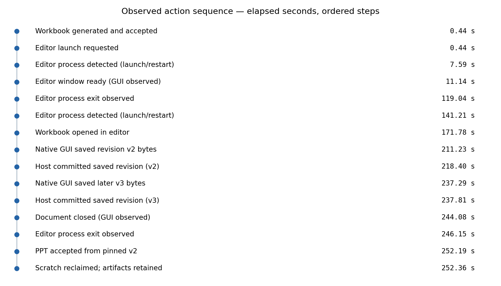
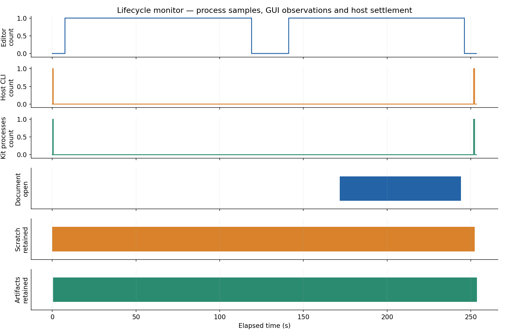
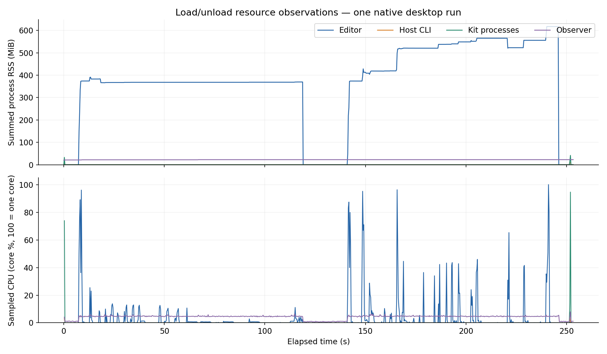

# 实际 LibreOffice 保存回环

[English](../../../../../../examples/log-report/acceptance/native-office/README.md) · 中文译文，以英文为准。 · [中文目录](../../../../README.md)

在 macOS ARM64 上使用官方 LibreOffice 26.8.1 桌面应用程序观察到。
这是一个手动原生 UI 验收测试，不是 CI GUI 模拟。操作员使用
原生可访问性控件和键盘输入来编辑 `Report!E8` 和 `F8`，
然后调用保存并选择 **使用 Excel 2007 格式** 在应用程序中。
没有 Python 代码编写或审查工作簿的单元格内容。

## 结果

- 初始生成的 XLSX：6,438 字节。
- 原生保存 v2：9,779 字节，SHA-256
  `0ce8daf7f9f726f79e8e26acbf14cbe512f1ffcf3d9ac426372be66f4a19e6f8`。
- 原生保存 v3：9,785 字节，SHA-256
  `dc65d39c498328350fd1e2ab2f4490baea388cafa8bc073a8a99f53547a09456`。
- v2 的注释：`Reviewed in LibreOffice investigate API timeouts`。
- v3 的注释：`Later LibreOffice edit keep downstream pinned to v2`。
- 在提交 v3 后，下游配置文件显式绑定 v2。其接受的三页 PPTX 包含 v2 的注释，而不是 v3 的，输入来源等于 v2 的版本。演示文稿仍保持原生可编辑的文本/表格对象。
- 生产者和演示文稿临时文件在确认收尾完成后都被回收。
  读取正式的 v1、v2 和 v3 文档仍成功。
- 零模型调用。不需要新的运行时后端、核心更改或文档库耦合
  在宿主中。宿主版本在 `acceptance.json` 中固定。

两个保存文件中的生产者属性均标识 LibreOffice。这证实了操作员观察到的 UI 保存；它并不验证人类作者。原生文件保持本地，因为桌面应用程序可能会添加个人元数据。公开记录仅包含哈希值和合成示例数据。

## 操作序列和加载/卸载

[独立报告](../../../../../../examples/log-report/acceptance/native-office/index.html)、[托管接受](../../../../../../examples/log-report/acceptance/native-office/acceptance.json)、
[资源摘要](../../../../../../examples/log-report/acceptance/native-office/observations.json)、[有序事件](../../../../../../examples/log-report/acceptance/native-office/events.json) 和
[便携式样本](../../../../../../examples/log-report/acceptance/native-office/samples.jsonl) 与图表一同提供。包含 SVG 版本。

采样峰值为 617.2 MiB 编辑器 RSS，9.5 MiB 宿主 RSS 和 41.9 MiB 工具 RSS。
观察到的 CPU 时间大约为编辑器 8.77 秒，宿主调用 0.020 秒，工具进程 0.529 秒，可选观察者 10.62 秒。这些是采样的下限进程观察，不是能耗测量。观察者的最终采样自然在其自身退出前进行。其终止由完成标记确认。宿主/工具峰值和 CPU 峰值可能在 250 ms 内被遗漏。

捕获包括一个停滞的文件对话框尝试、用户协助的编辑器退出和一次成功的重启。在 GUI 编辑前，相同的未修改工作副本被移动到一个可见的专用临时目录。不要将 160.6 秒的打开间隔或大约 11–12 秒的保存窗口解释为应用程序的固有性能：它们包括工具回环、操作员等待和 XLSX 警告。一个单独的首次启动捕获已过期并被排除在此成功运行之外。

使用 `/tmp` 符号链接的初始 v2 提交被宿主明确拒绝。协调确认没有任何版本已被提交；通过其规范路径提交相同的保存字节成功。没有放松路径限制。

应用程序进程、文档、工具进程和临时/文档通道描述了不同的生命周期。关闭工作簿并未立即卸载整个应用程序；退出才做到这一点。这不是一个 spool/VM 热加载演示或内存泄漏测试。RSS 可能多次计数共享页面；缺失的测量仍未知。请参阅 [操作程序](../../desktop/README.md) 以重复此过程。
