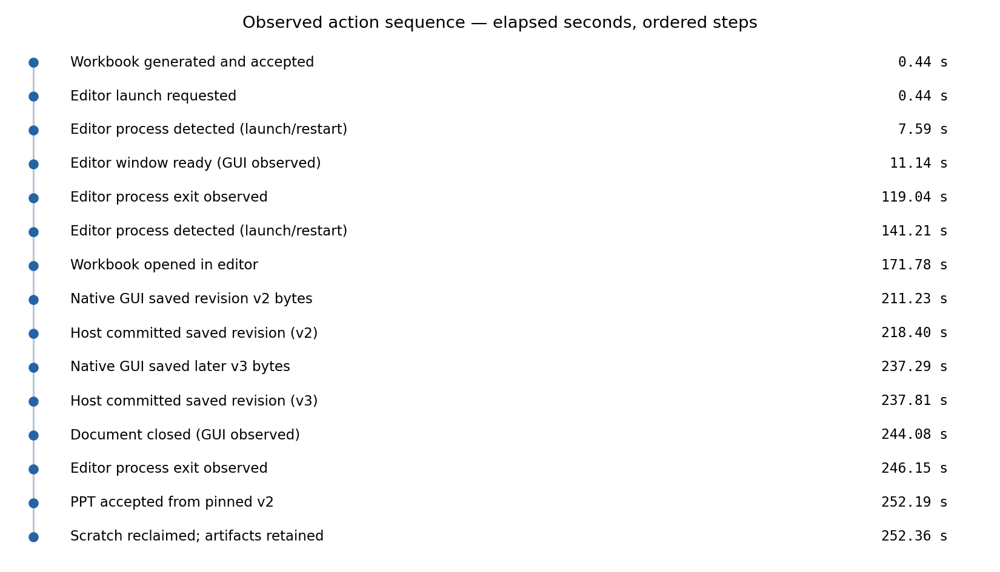
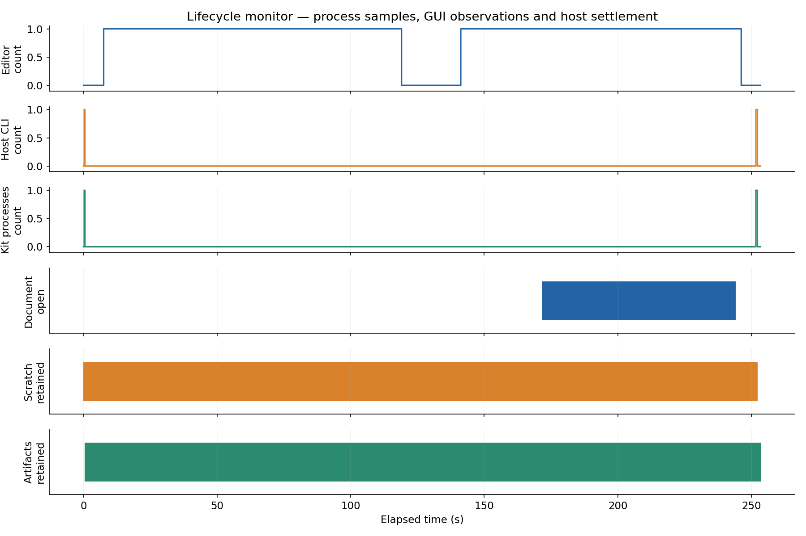
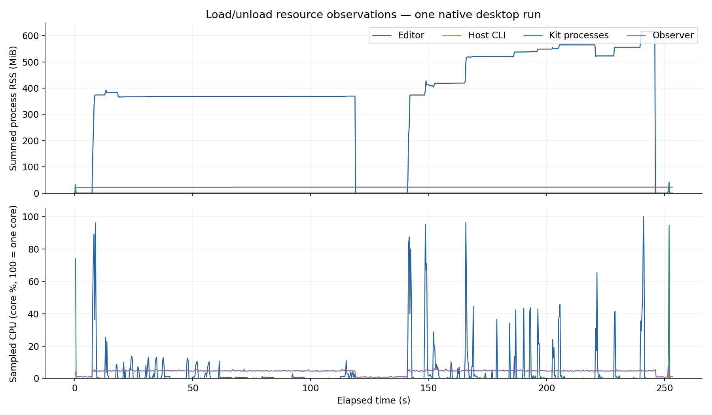

# Real LibreOffice save roundtrip

Observed on macOS ARM64 with the official LibreOffice 26.8.1 desktop application.
This is a manual native-UI acceptance, not a CI GUI simulation. The operator used
native accessibility controls and keyboard input to edit `Report!E8` and `F8`,
then invoked Save and selected **Use Excel 2007 Format** in the application.
No Python code wrote either reviewed workbook's cell contents.

## Result

- Initial generated XLSX: 6,438 bytes.
- Native saved v2: 9,779 bytes, SHA-256
  `0ce8daf7f9f726f79e8e26acbf14cbe512f1ffcf3d9ac426372be66f4a19e6f8`.
- Native saved v3: 9,785 bytes, SHA-256
  `dc65d39c498328350fd1e2ab2f4490baea388cafa8bc073a8a99f53547a09456`.
- v2's note: `Reviewed in LibreOffice investigate API timeouts`.
- v3's note: `Later LibreOffice edit keep downstream pinned to v2`.
- After committing v3, the downstream profile bound v2 explicitly. Its accepted
  three-slide PPTX contained v2's note and not v3's, with input provenance equal
  to the v2 revision. The presentation remained native editable text/table objects.
- Both producer and presentation scratch were reclaimed after confirmed settlement.
  Read-back of the formal v1, v2 and v3 artifacts still succeeded.
- Zero model calls. No new runtime backend, core change or document-library coupling
  in the host was needed. Host revision is pinned in `acceptance.json`.

The producer property in both saved files identifies LibreOffice. This corroborates
operator-observed UI saves; it does not authenticate a human author. Native files
remain local because desktop applications may add personal metadata. Public
records contain hashes and synthetic example data only.

## Action sequence and load/unload

[Standalone report](index.html), [custody acceptance](acceptance.json),
[resource summary](observations.json), [ordered events](events.json) and
[portable samples](samples.jsonl) accompany the figures. SVG versions are included.

Sampled peaks were 617.2 MiB editor RSS, 9.5 MiB host RSS and 41.9 MiB kit RSS.
Observed CPU time was approximately 8.77 s for the editor, 0.020 s for host calls,
0.529 s for kit processes and 10.62 s for the optional observer. These are sampled
lower-bound process observations, not energy measurements. The observer's final
sample is naturally taken before its own exit. Its termination was confirmed by
the completion marker. Host/kit peaks and CPU bursts can be missed at 250 ms.

The capture includes a stalled file-dialog attempt, user-assisted editor exit and
a successful restart. The identical unmodified working copy was moved to a visible,
dedicated temporary directory before GUI editing. Do not interpret the 160.6 s
open interval or approximately 11–12 s save windows as intrinsic application
performance: they include tool round trips, operator waits and the XLSX warning.
A separate first-launch capture expired and is excluded from this successful run.

An initial v2 submission using the `/tmp` symlink was explicitly refused by the
host. Reconciliation confirmed no version had been committed; submitting the same
saved bytes through their canonical path succeeded. No path gate was relaxed.

The application process, document, kit process and scratch/artifact lanes describe
different lifecycles. Closing the workbook did not immediately unload the entire
application; quitting did. This is not a spool/VM hot-load demonstration or a
memory-leak test. RSS can count shared pages more than once; missing measurements
remain unknown. See the [operator procedure](../../desktop/README.md) to repeat.
